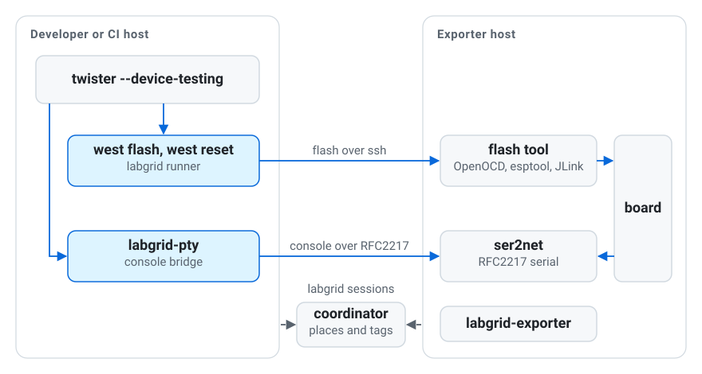

# zephyr-labgrid

[](https://github.com/ozan956/zephyr-labgrid/actions/workflows/ci.yml)
[](https://ozan956.github.io/zephyr-labgrid/)
[](LICENSE)

Flash, reset and test Zephyr on boards in a [labgrid](https://github.com/labgrid-project/labgrid)
lab as if they were on your desk.

<picture>
  <source media="(prefers-color-scheme: dark)" srcset="docs/images/pieces-dark.svg">
  
</picture>

```sh
labgrid-client -p stm32f746g-disco acquire
west build -b stm32f746g_disco samples/hello_world
west flash -r labgrid
labgrid-pty
labgrid-twister-hwmap -o map.yml
twister --device-testing --hardware-map map.yml -T tests/kernel
```

## Features

- A `labgrid` west runner for `west flash` and `west reset`. The flash tool
  runs on the exporter next to the board.
- `labgrid-pty`, a console bridge for Twister and for interactive use.
- `labgrid-twister-hwmap`, which writes a Twister hardware map from the
  places of the lab. Each test takes a free board and gives it back.
- `labgrid-twister-check`, which finds setup problems before the first run.
- No place names in daily commands, and no changes to Zephyr or labgrid.

## Getting started

Install into the Python environment that runs west and Twister.

```sh
pip install "labgrid @ git+https://github.com/labgrid-project/labgrid.git"
git clone https://github.com/ozan956/zephyr-labgrid.git
pip install -e ./zephyr-labgrid
export ZEPHYR_EXTRA_MODULES=$PWD/zephyr-labgrid
```

Point the tools at your lab and check the setup.

```sh
export LG_COORDINATOR=lab-coordinator:20408
export ZEPHYR_LABGRID_ENV_DIR=/shared/labgrid-envs
labgrid-twister-check -p stm32f746g-disco
```

Without a lab, [One board on your desk](https://ozan956.github.io/zephyr-labgrid/quickstart/)
sets up a complete lab on one machine.

## Documentation

The documentation is at https://ozan956.github.io/zephyr-labgrid/.

- [For Zephyr developers](https://ozan956.github.io/zephyr-labgrid/flash-and-test/), your routine next to a board on your desk
- [For lab owners](https://ozan956.github.io/zephyr-labgrid/prepare-a-lab/), places, environment files and tags
- [Best practices](https://ozan956.github.io/zephyr-labgrid/best-practices/)
- [Design notes](https://ozan956.github.io/zephyr-labgrid/design/), for contributors

## Status

This is an experimental release (0.1). It needs Zephyr 4.4 or newer,
Python 3.11 or newer, labgrid master and a Linux host. It is tested with
Zephyr 4.5 on an STM32F746G-DISCO, an ESP32-DevKitC and an Alif Ensemble
E8 DevKit. `west debug` and several consoles per board are not supported
yet, see [What is supported](https://ozan956.github.io/zephyr-labgrid/flash-and-test/#supported).

## Contributing

Reports from other labs and boards are welcome as issues. To run the tests,
install with `pip install -e ".[test]"` and run `ZEPHYR_BASE=/path/to/zephyr pytest`.

## License

Apache-2.0, see [LICENSE](LICENSE).
