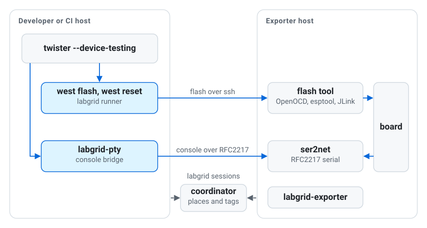
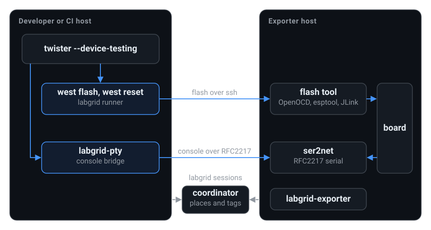

.. meta::
   :description: Flash, reset and test Zephyr on boards in a labgrid lab.

.. _index:

zephyr-labgrid
==============

``zephyr-labgrid`` lets you flash, reset and test Zephyr on boards in a
`labgrid <https://labgrid.readthedocs.io/>`_ lab as if they were on your
desk. ``west flash`` and Twister work unchanged. The module adds a
``labgrid`` west runner and a ``labgrid-pty`` console bridge, and the flash
tool runs on the exporter next to the board.

This is an experimental release (0.1). It is tested with Zephyr 4.5 and
labgrid master on an STM32F746G-DISCO, an ESP32-DevKitC and an Alif Ensemble
E8 DevKit.

Where to start
--------------

* Try the module with one board on one machine, see :ref:`quickstart`.
* Flash, reset and run Twister on a lab board, see :ref:`flash-and-test`.
* Make your labgrid places ready for Zephyr users, see :ref:`prepare-a-lab`.
* Avoid the usual traps, see :ref:`best-practices`.
* Find out how it works inside, see :ref:`design`.

How the pieces fit together
---------------------------

         and ser2net on the exporter host. Both hosts keep a session with the
         labgrid coordinator, which holds places, owners and tags.

         and ser2net on the exporter host. Both hosts keep a session with the
         labgrid coordinator, which holds places, owners and tags.

On the developer side the module adds the ``labgrid`` west runner and the
``labgrid-pty`` console bridge. Zephyr and labgrid are used as they are.
The complete :external+labgrid:doc:`labgrid documentation <index>` and the
:external+zephyr:doc:`Twister documentation <develop/twister/index>` help
when you need options beyond the workflows here.

.. toctree::
   :hidden:

   quickstart
   flash-and-test
   prepare-a-lab
   best-practices
   design
