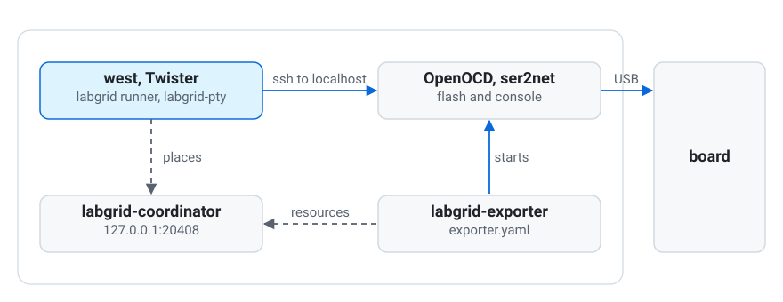
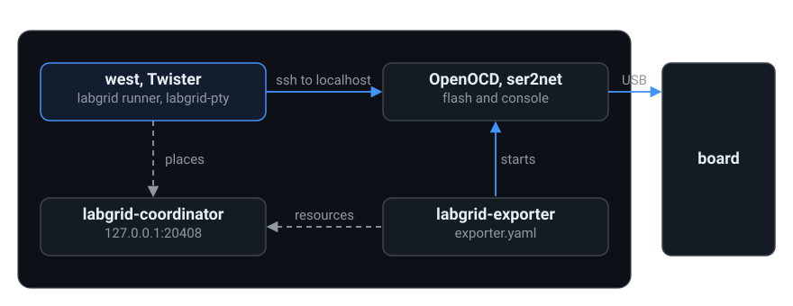

.. meta::
   :description: Build a complete labgrid lab on one machine and try the module.

.. _quickstart:

One board on your desk
======================

This page builds a complete labgrid lab on one Linux machine with one
board, so you can try the module before you have a real lab. The same
steps, split over two machines, give you a remote lab.

         the board is plugged into it.

         the board is plugged into it.

The example is an STM32F746G-DISCO with its on-board ST-Link. For other
boards, change the exporter entry and the environment file (see
:ref:`prepare-a-lab`).

1. Install
----------

You need a Zephyr workspace that builds ``samples/hello_world`` for your
board, and these tools on the same machine.

-  ``openocd`` 0.11 or newer and ``ser2net`` (4.6.1 or newer if you can, see
   :ref:`check-exporter-host`)
-  ssh to ``localhost`` without a password prompt. labgrid reaches exported
   resources over ssh, also when the exporter is on the same machine.

Install the Python packages in the environment that runs west, from the
top of the workspace.

.. code-block:: console

   $ cd ~/zephyrproject
   $ pip install "labgrid @ git+https://github.com/labgrid-project/labgrid.git"
   $ git clone https://github.com/ozan956/zephyr-labgrid.git
   $ pip install -e ./zephyr-labgrid
   $ export ZEPHYR_EXTRA_MODULES=$PWD/zephyr-labgrid

Every terminal of the following steps needs this Python environment and
the ``export`` lines, so put them into your shell profile.

2. Describe the board for the exporter
--------------------------------------

Find the serial number of the probe.

.. code-block:: console

   $ udevadm info -q property -n /dev/ttyACM0 | grep ID_SERIAL_SHORT

Write ``exporter.yaml``. The ST-Link provides both the debug probe and the
console UART, so match both on the same serial number.

.. code:: yaml

   stm32f746g-disco:
     USBDebugger:
       match:
         ID_SERIAL_SHORT: '066CFF505356867767051752'
     USBSerialPort:
       match:
         ID_SERIAL_SHORT: '066CFF505356867767051752'
         ID_USB_INTERFACE_NUM: '02'
       speed: 115200

3. Start the coordinator and the exporter
-----------------------------------------

Run them in their own terminals, or in the background. The coordinator
keeps its places in ``places.yaml`` in its working directory, so start it
from the same directory every time.

.. code-block:: console

   $ labgrid-coordinator -l 127.0.0.1:20408
   $ labgrid-exporter -c 127.0.0.1:20408 -n lab --hostname localhost exporter.yaml

4. Create the place
-------------------

.. code-block:: console

   $ export LG_COORDINATOR=127.0.0.1:20408
   $ labgrid-client -p stm32f746g-disco create
   $ labgrid-client -p stm32f746g-disco add-match "lab/stm32f746g-disco/*"
   $ labgrid-client -p stm32f746g-disco set-tags \
       zephyr_platform=stm32f746g_disco/stm32f746xx \
       zephyr_env=stm32f746g_disco/labgrid.yaml

``zephyr_env`` names the labgrid environment file for the board, relative to
``ZEPHYR_LABGRID_ENV_DIR``. The module ships one for this board in
``examples/``.

.. code-block:: console

   $ export ZEPHYR_LABGRID_ENV_DIR=$ZEPHYR_EXTRA_MODULES/examples

5. Take the board, check, flash, test
-------------------------------------

Take the place and check the setup.

.. code-block:: console

   $ labgrid-client -p stm32f746g-disco acquire
   $ labgrid-twister-check -p stm32f746g-disco

The check prints one line per check, see :ref:`an example <check-output>`.
Fix any ``FAIL`` lines first.

.. code-block:: console

   $ west build -p -b stm32f746g_disco zephyr/samples/hello_world
   $ west flash -r labgrid

The runner uses the place you hold for the board. Watch the console in a
second terminal and reset the board.

.. code-block:: console

   $ labgrid-pty                       # Ctrl-] to stop
   $ west reset -r labgrid

You should see ``Hello World! stm32f746g_disco/stm32f746xx``.

Run Twister on the board. Where a board on your desk needs
``--device-serial /dev/ttyACM0``, pass ``--device-serial-pty labgrid-pty
--west-runner labgrid``.

.. code-block:: console

   $ west twister -p stm32f746g_disco/stm32f746xx --device-testing \
       --device-serial-pty labgrid-pty --west-runner labgrid \
       -T zephyr/samples/hello_world -T zephyr/samples/subsys/testsuite/pytest/shell

Give the board back when you are done.

.. code-block:: console

   $ labgrid-client -p stm32f746g-disco release

To let Twister take a free board for each test instead, write a hardware
map once and run Twister with it, see :ref:`flash-and-test`.

.. code-block:: console

   $ labgrid-twister-hwmap -o map.yml
   $ west twister --device-testing --hardware-map map.yml -T zephyr/samples/hello_world

Next
----

-  Move the exporter to the machine the boards are plugged into and point
   ``LG_COORDINATOR`` and ``-c`` at the coordinator host. Nothing else changes.
-  To add more boards, see :ref:`prepare-a-lab`.
-  For day-to-day use, see :ref:`flash-and-test`.
